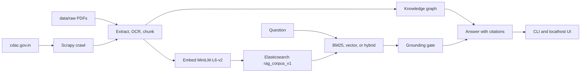

# C-DAC Unified RAG

Retrieval-augmented question answering over the public [C-DAC](https://cdac.gov.in/) website. One application crawls HTML and PDFs, ingests uploaded documents, indexes a single Elasticsearch corpus, and answers with hybrid retrieval, citations, and an optional knowledge graph.

This is an internship project by **Vyom Desai**. It unifies an earlier Scrapy crawler and a PDF RAG pipeline into the `rag` package. Phase 1 is the crawl-to-answer application. Agent-tool orchestration is left for a later phase.

## What it does

- Crawls `cdac.gov.in` with Scrapy: robots.txt, sitemaps, bounded page count, retries, a crawl ledger, and success/error logs.
- Downloads PDFs found during the crawl and accepts extra PDFs dropped in `data/raw`.
- Extracts page text, falls back to Tesseract OCR for scanned pages, and keeps figure, table, and equation references.
- Chunks HTML and PDF text, builds extractive and composite summaries, and embeds chunks with `sentence-transformers/all-MiniLM-L6-v2` (384 dimensions).
- Indexes HTML, crawled PDFs, and uploaded PDFs in one Elasticsearch index, `rag_corpus_v1`.
- Retrieves with BM25, dense vector search, or hybrid fusion (min-max by default, 0.3 keyword / 0.7 semantic).
- Abstains when retrieval is empty, the top score is below the grounding threshold, or a requested role is not supported by the hits.
- Builds a small knowledge graph (organizations, products, services, people, and related types) and can fold it into an answer.
- Exposes the same flow through a CLI and a localhost inspector at `http://127.0.0.1:8765`.

The default language model is a mock that answers from the retrieved context. Point `LLM_ENDPOINT` at an OpenAI-compatible API, including a local Ollama server, to generate answers with a real model.

## Architecture



Source kinds stored on every record are `html`, `crawled_pdf`, and `uploaded_pdf`. Domain filters apply to website HTML and crawled PDFs. Uploaded PDFs stay visible when a domain filter is on.

## Tech stack

| Piece | Choice |
| --- | --- |
| Language | Python 3.12 |
| Crawl | Scrapy 2.11 |
| Search | Elasticsearch 8.12 (`elasticsearch` 8.x client) |
| Embeddings | `sentence-transformers/all-MiniLM-L6-v2` |
| PDF / OCR | PyMuPDF, pypdf, Pillow, Tesseract (`pytesseract`) |
| Graph | NetworkX-backed store in `data/kg/graph_v1.json` |
| Config | `config/settings.yaml`, overridden by `.env` |
| API / UI | Standard-library HTTP server on port 8765 |
| Containers | Docker Compose: Elasticsearch 8.12.2, app, optional UI |

## Requirements

- Python 3.12
- Elasticsearch 8.12, or Docker so Compose can start it
- Enough disk and RAM for the embedding model and a local Elasticsearch node (Compose limits the JVM to 512 MB)
- Optional: [Tesseract OCR](https://github.com/tesseract-ocr/tesseract) on `PATH` for scanned pages. If it is missing, those pages are flagged `requires_ocr` and skipped rather than failing the run.
- Optional: an OpenAI-compatible chat endpoint if you want answers beyond the mock provider

The crawler identifies itself as `CdacResearchBot/1.0 (Educational)`, obeys `robots.txt`, waits 1.5 seconds between downloads, and stops at 500 pages or 60 minutes unless you change `config/settings.yaml`.

## Setup

From the repository root in PowerShell:

```powershell
python -m venv .venv
.\.venv\Scripts\Activate.ps1
python -m pip install -r requirements.txt
Copy-Item .env.example .env
docker compose up -d elasticsearch
```

On bash, activate with `source .venv/bin/activate` and copy the env file with `cp .env.example .env`. The `python` commands are the same.

Elasticsearch is published on `http://localhost:9200` with security disabled. That setting is for this single-node local stack only.

Check that the app can see the cluster:

```powershell
python run.py status
```

`status` exits 0 even when Elasticsearch is down, and reports `elasticsearch_available: false`.

### Docker app and UI

```powershell
docker compose up -d elasticsearch app
docker compose --profile ui up -d ui
```

The UI container listens on `0.0.0.0:8765` inside the container. Compose publishes that port only on the host loopback interface, `127.0.0.1:8765`. A direct `python run.py ui` process also binds `127.0.0.1`.

The `app` service waits until Elasticsearch is healthy, then runs `python run.py --help`. Override `command` when you want a crawl or index step inside the container. Crawl output, PDFs, and the index volume mount from `./data`.

## Pipeline

Run these from the repository root, in order, after Elasticsearch is up:

```powershell
python run.py crawl
python run.py process-pdfs
python run.py ingest-all
python run.py index
python run.py build-kg
python run.py ask "What C-DAC evidence answers this question?"
```

Place manually uploaded PDFs in `data/raw` before `ingest-all`. Crawled PDFs land in `data/pdfs` and are processed by `process-pdfs`. Both paths share the PDF extractor, then crawled PDFs keep their website lineage.

`crawl` accepts `--url`, `--domain`, `--max-urls`, and `--crawl-attempts`. A single uploaded file can be ingested on its own:

```powershell
python run.py ingest --pdf data/raw/example.pdf
```

## Asking questions

`query` returns ranked hits and whether grounding would abstain. `ask` generates an answer.

```powershell
python run.py query "Where is the C-DAC Pune centre located?" --mode hybrid --top-k 5
python run.py ask "What is C-DAC's Aadhaar Data Vault service?" --mode hybrid --include-kg
```

Flags for `query` and `ask`:

| Flag | Values | Meaning |
| --- | --- | --- |
| `--mode` | `bm25`, `vector`, `hybrid` | Retrieval method. Default is hybrid. |
| `--top-k` | integer | Hits kept after fusion. Default is 5. |
| `--sources` | `all`, `html`, `pdf`, `uploaded_pdf`, `crawled_pdf` | Corpus slice. |
| `--domain` | hostname | Restrict website hits. Uploaded PDFs stay included. |
| `--include-kg` | flag on `ask` only | Add knowledge-graph context. |

Hybrid search pulls a candidate pool (default 20), min-max normalizes BM25 and vector scores, and combines them with weights 0.3 and 0.7. `fusion_strategy` can be switched to reciprocal rank fusion in config. Figure, table, and image mentions in the question can boost matching chunks.

Grounding refuses an answer when there are no hits, the top score is below `0.35`, or the question names a role (`Executive Director`, `Director`, `Scientist`, `Engineer`) that the retrieved text does not contain. The abstain sentence is: `The information is not available in the provided context.`

### Local model

`.env.example` leaves the mock provider in place. To call a local Ollama model, set:

```text
LLM_PROVIDER=custom_api
LLM_ENDPOINT=http://127.0.0.1:11434/v1/chat/completions
LLM_MODEL=llama3.2
```

If `LLM_ENDPOINT` is set and `LLM_PROVIDER` is not, the loader selects `custom_api`. Do not commit `.env`. API keys, when you use them, stay in that file and are masked in config dumps.

Recorded demo questions and source lists are in [`docs/demo-results/responses.md`](docs/demo-results/responses.md).

## HTTP API

```powershell
python run.py ui
python run.py ui --port 8765
```

| Method | Path | Purpose |
| --- | --- | --- |
| `GET` | `/` | Pipeline dashboard JSON |
| `GET` | `/graph` | Knowledge-graph snapshot, truncated for the page |
| `GET` | `/validate?url=` | Trace one crawled page through extraction |
| `GET` | `/search?q=` | Compare Elasticsearch hits with graph hits |
| `POST` | `/ask` | Grounded answer |

```powershell
Invoke-RestMethod -Method Post -Uri http://127.0.0.1:8765/ask `
  -ContentType application/json `
  -Body '{"query":"What does the indexed corpus say?","mode":"hybrid","sources":"all","include_kg":true}'
```

Optional JSON fields are `top_k`, `mode`, `sources`, `domain`, and `include_kg`. A successful body has:

| Field | Meaning |
| --- | --- |
| `query` | Question that was asked |
| `answer` | Generated or abstained text |
| `abstained` | Whether the grounding gate refused |
| `abstain_reason` | `no_retrieval_hits`, `score_below_threshold`, or `role_mismatch` |
| `sources` | Citations: document, URL, pages, section, score, retrieval method, lineage |
| `retrieval_mode` | Mode actually used |
| `sources_filter` | Source filter actually used |
| `chunks_retrieved` | Number of chunks passed into the prompt |
| `include_kg` | Whether the graph was consulted |

Invalid JSON or a bad argument returns `400`. Unexpected failures return `500` with an `error` string.

## Other commands

| Command | Purpose |
| --- | --- |
| `status` | Project name, index, and whether Elasticsearch responds |
| `crawl` | Run the `cdac` Scrapy spider |
| `process-pdfs` | Extract crawled PDFs |
| `ingest --pdf PATH` | Extract one uploaded PDF |
| `ingest-all` | Extract every PDF in `data/raw` |
| `index` | Embed artifacts and write `rag_corpus_v1` |
| `build-kg` | Rebuild `data/kg/graph_v1.json` from all chunks |
| `query` | Retrieve and report the grounding decision |
| `ask` | Retrieve, ground, and answer |
| `evaluate` | Hit rate, reciprocal rank, and recall for BM25, vector, hybrid, and the graph |
| `benchmark-hnsw` | Compare brute-force and HNSW latency on synthetic vectors |
| `validate-page URL` | Check one HTML page trace. Add `--pdf` for a PDF URL |
| `validate-links` | Check `evaluation/representative_links.json` |
| `report` | Build the pipeline report. `--output PATH` writes it |
| `ui` | Start the inspector |

```powershell
python run.py evaluate --benchmark rag/eval/fixtures/benchmark.jsonl
python run.py benchmark-hnsw --top-k 5
python run.py report --output data/reports/pipeline_report.json
python run.py --help
```

`evaluate` reports `bm25_only`, `vector_only`, `hybrid_0.3_0.7`, and `knowledge_graph`. Use `EMBEDDING_PROVIDER=local` when you want the vector and hybrid numbers to reflect the real MiniLM model. The checked-in benchmark is a fixture for the metric code, not a full labeled set of the live site.

## Configuration

Defaults live in [`config/settings.yaml`](config/settings.yaml). Environment variables override them. `load_config` reads `.env`, then YAML, then any `AppConfig` field name in uppercase (`ELASTICSEARCH_URL`, `RETRIEVAL_MODE`, `TOP_K`, and the rest).

Values you are most likely to change:

| Setting | Default | Role |
| --- | --- | --- |
| `CRAWL_START_URL` | `https://cdac.gov.in/` | Crawl seed |
| `CRAWL_ALLOWED_DOMAIN` | `cdac.gov.in` | Host the spider may visit |
| `ELASTICSEARCH_URL` | `http://localhost:9200` | Cluster address. Compose sets `http://elasticsearch:9200` inside containers |
| `ELASTICSEARCH_INDEX` | `rag_corpus_v1` | Single corpus index |
| `EMBEDDING_MODEL` | `sentence-transformers/all-MiniLM-L6-v2` | Local embedding model |
| `RETRIEVAL_MODE` | `hybrid` | `bm25`, `vector`, or `hybrid` |
| `KB_SOURCE` | `all` | `all`, `html_only`, `pdf_only`, `html_and_pdf`, or `uploaded_pdf_only` |
| `LLM_PROVIDER` | `mock` | `mock`, or `custom_api` / `openai` with an endpoint |

HTML chunks use a max of 1200 characters, overlap 150, minimum 80, and a composite group size of 10. PDF chunks use a max of 1200, overlap 100, minimum 300, and a near-duplicate cosine cutoff of 0.92. Keyword and semantic weights must sum to 1.

Copy [`.env.example`](.env.example) to `.env`. Never commit `.env`, Elasticsearch passwords, or LLM API keys.

## Project layout

```text
run.py                 CLI entry point
scrapy.cfg             Scrapy project pointer
config/settings.yaml   Defaults
rag/crawl              Spider, discovery, pipelines, ledger
rag/extract            PDF text, OCR, reference metadata
rag/index              Chunking, summaries, embeddings, Elasticsearch writer
rag/retrieve           BM25, vector, hybrid fusion, source and domain filters
rag/graph              Entity and relation extraction, JSON graph store
rag/answer             Grounding, prompts, mock and HTTP LLM clients
rag/services.py        search_corpus, search_kg, answer_question
rag/ui.py              Inspector and POST /ask
rag/eval               Benchmark metrics and HNSW timing
evaluation             Representative-link list and a benchmark file
tests                  Unit and contract tests
docker                 Compose entrypoint and UI server
docs                   Scope, current verification, demo answers, internship write-up
data                   Local corpus. Not part of the git tree except empty folders
```

`search_corpus`, `search_kg`, and `answer_question` in `rag.services` are ordinary Python functions used by the CLI and UI. A later phase can expose those three as agent tools. This repository does not include LangGraph, AutoGen, CrewAI, query rewriting, multi-turn memory, or a cross-encoder reranker.

## Data that stays on your machine

`.gitignore` keeps generated corpus files out of git:

- everything under `data/` except the empty `.gitkeep` folders (`raw`, `pdfs`, `extracted`, `logs`, `reports`, `kg`)
- `cdac_output.csv` and `cdac_output.json` if a crawl export is written at the repo root
- `.env`, `.venv`, caches, and `docs/report_build/node_modules`

After a real crawl you will have PDFs, extracted JSON, logs, a crawl report, and `data/kg/graph_v1.json` locally. Clone the repo, then run the pipeline to recreate them. The internship report and review slides under `docs/` are project write-ups, separate from the runnable corpus.

## Tests

```powershell
python -m pytest tests -q
python run.py --help
```

The last recorded suite result is **280 passed, 3 skipped**, with CLI help and `status` while Elasticsearch was down both exiting 0. A live container ingest and a live Tesseract pass were not part of that run. Details are in [`docs/CURRENT_STATE.md`](docs/CURRENT_STATE.md). Scope boundaries are in [`docs/PHASE1_SCOPE.md`](docs/PHASE1_SCOPE.md).

## License

Released under the [MIT License](LICENSE).
